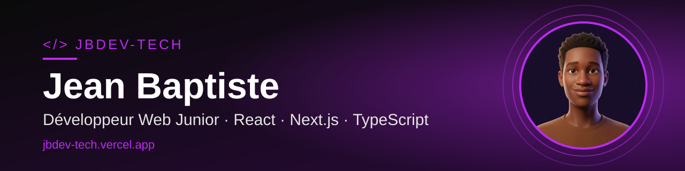

 

<h1 align="center">Salut, moi c'est Jean Baptiste 👋</h1>

  <strong>Développeur web junior · Étudiant en Génie Logiciel</strong> 
  Lomé, Togo

  
  

---

## À propos

Je suis étudiant en Licence 3 de Génie Logiciel et développeur web junior. J'aime transformer des idées en applications web utiles, avec une attention particulière portée à l'expérience utilisateur et à la qualité du code.

Au quotidien, je travaille principalement avec React, Next.js et TypeScript. J'apprends en construisant des projets, en testant de nouvelles approches et en améliorant progressivement ce que je développe.

Je recherche actuellement un **stage en développement web** pour mettre mes compétences en pratique, apprendre auprès d'une équipe et participer à des projets concrets.

## Technologies

  

## Projets

### My-portfolio

Mon portfolio personnel, conçu pour présenter mon parcours, mes projets et faciliter les prises de contact grâce à un formulaire fonctionnel.

- **Technologies :** Next.js, TypeScript, Tailwind CSS, Resend
- **Code source :** [JbDev-tech/My-portfolio](https://github.com/JbDev-tech/My-portfolio)
- **Démo :** [jbdev-tech.vercel.app](https://jbdev-tech.vercel.app)

### talk_ai

Une application web qui permet de discuter avec le contenu d'une page web grâce à l'intelligence artificielle.

- **Technologies :** Next.js, Upstash Redis, Tailwind CSS
- **Code source :** [JbDev-tech/talk_ai](https://github.com/JbDev-tech/talk_ai)

## Statistiques GitHub

  
  

## Contributions

  <picture>
    <source media="(prefers-color-scheme: dark)" srcset="https://raw.githubusercontent.com/JbDev-tech/JbDev-tech/output/github-snake-dark.svg" />
    <source media="(prefers-color-scheme: light)" srcset="https://raw.githubusercontent.com/JbDev-tech/JbDev-tech/output/github-snake.svg" />
    
  </picture>

---

  <i>J'apprends, je construis et je progresse un projet à la fois.</i>

